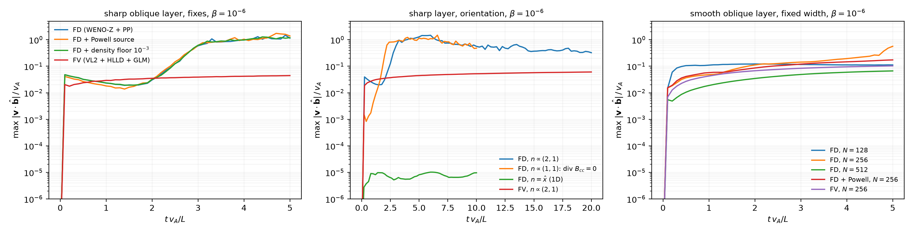

# Static force-free rotational layers (oblique, low beta)

A minimal test for spurious field-aligned forces of the MHD schemes at low
plasma beta: the configuration that, in the supersonic ISM turbulence at
512^3, evacuates strongly magnetised cells until the Alfven speed collapses the
time step.

**Set-up.** Uniform density and gas pressure, gas at rest. A field of constant
magnitude `B0 = 1` rotates in the plane normal to `n = (2, 1, 0)/sqrt(5)`
across two tanh layers (`theta: 0 -> pi -> 2 pi`), on a periodic
`N x N x 8` slab. The field is divergence-free and force-free (`J || B`), and
the total pressure is uniform, so the exact solution is static. The direction is
not 45 degrees on purpose: there the interpolated cell-centred field has no
central divergence by symmetry. The field comes from a vector potential, so the
CT face fields of the finite-difference scheme are discretely divergence-free;
only the cell-centred field the fluxes see carries a divergence.

**Diagnostics** (every chunk, reduced on the GPU), against time in Alfven
crossing times of the box (`v_A = 1`):

| quantity | meaning |
|---|---|
| `v_par` | max `|v . b|`, the field-aligned speed: purely numerical |
| `v_normal` | max `|v . n|`: numerical diffusion of the rotation lowers `|B|` in the layer and drives a genuine inflow along `n` |
| `v_max`, `rho_min`, `b_min` | max speed, min density, min field strength |
| `dt` | the time step the CFL condition sets |
| `divb` | max `dx |div B_cc| / |B|` (2nd-order central) of the cell-centred field |

**Schemes.** `fd`: WENO-Z + positivity-preserving WENO, SSPRK4, CT,
`C_cfl = 0.75` (the turbulence production setting). `fd_powell`: plus the
Godunov-Powell source `-B_cc div B_cc` (6th-order central divergence) in every
stage, added inside the script. `fd_floor`: plus AthenaPK's density floor at
`1e-3` (`POSITIVITY_HARD_FLOOR`). `fv`: AthenaPK's VL2 + PLM + HLLD with GLM
cleaning, `C_cfl = 0.3`.

```bash
python force_free_layer.py --scheme fd --beta 1e-4 --width 0.5 --N 256   # one case -> data/*.npz
python force_free_layer.py --plot                                         # figures/force_free_layer.{png,pdf}
```

A run stops early when its time step falls below 1 % of the initial one, when
the state goes non-finite, or at the wall-time budget.

## Findings (GH200, float32, N = 256 unless noted, 5 Alfven times)



| case | max \|v.b\| / v_A | rho_min |
|---|---|---|
| FD, sharp oblique layer (half-width 0.5 cells), beta 1e-2 / 1e-4 / 1e-6 | 0.99 / 1.59 / 1.47 | 0.040 / 0.11 / 0.064 |
| FD + Powell source, sharp, beta 1e-4 / 1e-6 | 1.17 / 1.73 | 0.050 / 0.066 |
| FD + density floor 1e-3, sharp, beta 1e-4 / 1e-6 (never active) | 1.44 / 1.28 | 0.050 / 0.064 |
| FV (VL2 + HLLD + GLM), sharp, beta 1e-4 and 1e-6 | 0.045 | 0.81 |
| FD, sharp, 45 degree layer (no central div B_cc), beta 1e-6, 10 t_A | 1.48 | 0.055 |
| FD, sharp, grid-aligned layer (1D), beta 1e-6, 10 t_A | 1e-5 | 0.95 |
| FD, smooth layer (half-width 4 cells), beta 1e-2 / 1e-4 / 1e-6 | 0.14 / 0.20 / 0.56 | 0.58 / 0.45 / 0.31 |
| FD, same physical width at N = 128 / 512, beta 1e-6 | 0.12 / 0.067 | 0.79 / 0.80 |
| FD + Powell / FV, smooth layer, beta 1e-6 | 0.17 / 0.10 | 0.51 / 0.88 |

The sharp FD layers sit at the FV level (~0.03 v_A) for about two Alfven
times and then run away to field-aligned speeds of order v_A, evacuating the
layer by a factor 15-40, without a time-step collapse (20 t_A at beta 1e-6:
dt 9.3e-4 -> 8.1e-4). The runaway is not caused by the divergence of the
cell-centred field: it is the same at 45 degrees, where that divergence is zero
by symmetry, and the Powell source does not change it; the grid-aligned layer,
which is exactly one-dimensional on the grid and so cannot seed a perturbation
along the sheet, stays static. This points to an instability of the sharp
current sheet (tearing-type, enabled by the low dissipation of the FD scheme,
with Alfvenic outflows); the more diffusive FV scheme broadens the sheet and
does not develop it within 20 t_A. The divergence of the cell-centred field in
the oblique layer itself only produces the early plateau of a few per cent of
v_A.
